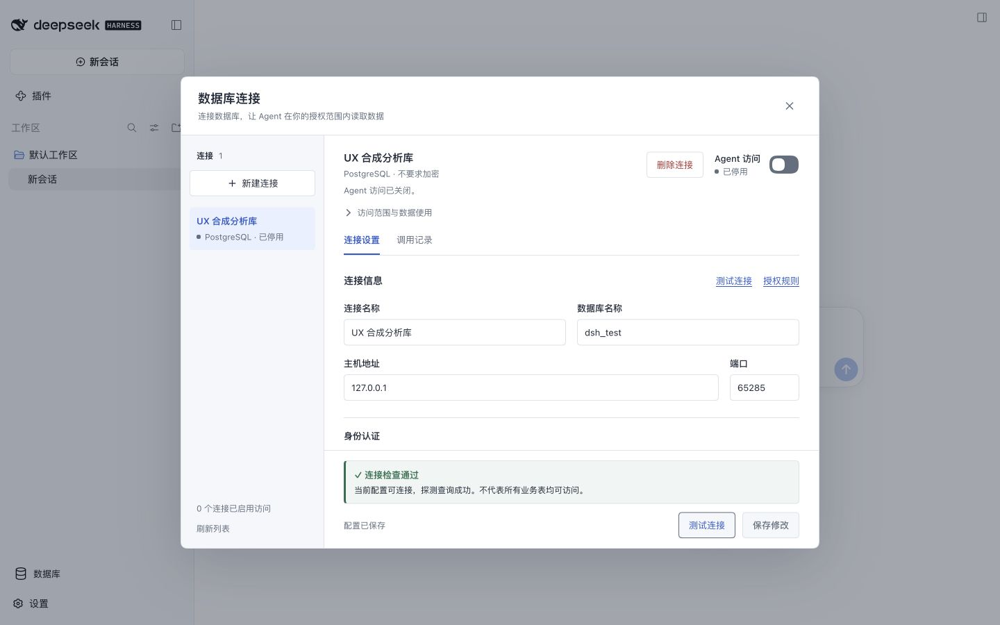
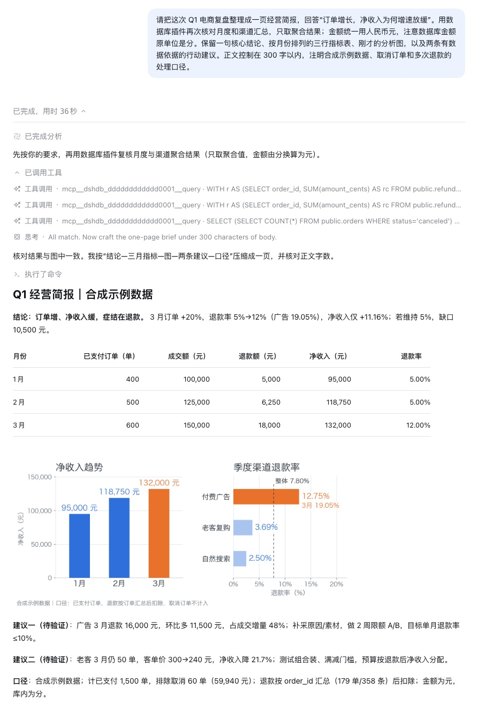

# dsh-database by blkpne

[简体中文](README.md) · [English](README.en.md) · [npm package](https://www.npmjs.com/package/dsh-database)

**A [DeepSeek Harness](https://github.com/deepseek-ai/deepseek-harness) database plugin for session-authorized schema discovery and read-only queries.**

Manage connections in DSH Web and let an agent inspect tables or collections before answering questions about your data. Supports **MySQL, MariaDB, PostgreSQL, SQL Server, Oracle, and MongoDB**. Agent access is off by default; you can restrict it to selected sessions or allow schema discovery without data queries.

Source: [blkpne/dsh-database](https://github.com/blkpne/dsh-database). npm package: [dsh-database](https://www.npmjs.com/package/dsh-database). To distinguish projects with similar names, check the repository owner and the npm package's Repository link.

[Quick start](#quick-start) · [Access and data boundaries](#access-and-data-boundaries) · [Documentation](#documentation) · [Contributing](CONTRIBUTING.md)



[View the full-size screenshot](https://github.com/blkpne/dsh-database/raw/refs/heads/main/docs/assets/connection-manager.jpg). The example connection contains no real credentials. The screenshot shows the Chinese UI labels used in the steps below.

## What it does

- **Manage database connections:** configure and test multiple database engines from one Web interface.
- **Discover schemas on demand:** search tables, views, and collections, then inspect fields, constraints, and indexes without loading the entire schema up front.
- **Control agent access:** keep access disabled until needed, restrict sessions, choose schema-only access, and set per-session call limits.
- **Diagnose calls:** inspect status, duration, error stage, and cancellation state. Plugin call records do not retain SQL, parameters, or business rows.

The plugin focuses on read-only data access. It does not provide database writes, result export, SQL history replay, or SSH tunnels. Use a database account with read-only permissions as well as the plugin's access controls.

## Quick start

### 1. Install the plugin

If DSH is already installed, stop the running `web` Profile before installing or updating:

```sh
dsh plugin --profile web add dsh-database@latest --ignore-scripts
```

This installs the built package from npm. You do not need to clone the repository or build it locally. Use the same command to update, then restart DSH Web.

If DSH is not installed yet:

```sh
npm install --global @deepseek-ai/dsh@latest
```

See the [compatibility matrix](docs/compatibility.md#宿主与平台) for Node.js requirements and tested DSH versions. On Windows PowerShell, you can use `npm.cmd` and `dsh.cmd`.

### 2. Start DSH Web

```sh
dsh --profile web --host 127.0.0.1 --port 3080 --no-open
```

DSH initializes the `web` Profile if needed. Open the login link printed in the terminal. The sidebar should include **数据库** (Database). On your first DSH run, follow the host's model setup prompts.

### 3. Authorize your first query

1. Open **数据库** (Database), create a connection, and enter the database address, database name, and a read-only account.
2. Select **测试当前配置** (Test current configuration). Save after the test succeeds. See [TLS connections](docs/usage.md#tls-连接) if you use a private certificate authority.
3. In **授权规则** (Authorization rules), choose the session scope and capabilities, then save. Enable **Agent 访问** (Agent access).
4. Ask in an authorized session, for example:

> Use the "Business analytics" connection to list the tables I can access. Inspect the relevant columns, count the orders, and explain which table you used.

A successful connection test does not save the settings or enable agent access. Query results and analysis appear in the agent conversation. **调用记录** (Call records) shows status, duration, and errors.

## Access and data boundaries

- New connections start with agent access **disabled**. Before enabling access, review the session scope: its default is all sessions in the current DSH host, and you can narrow it to selected sessions and their child agents.
- Schema-only authorization allows structural inspection without exposing the query tool. Call limits apply to both inspection and queries.
- Database permissions determine which data is readable. Session authorization determines which sessions can use a connection; it does not replace database permissions or provide a SQL object allowlist.
- Use read-only database accounts and views to restrict access. SQL Server's `readOnlyIntent` is a routing hint, not a write-permission boundary. SQL checks and read-only transactions do not make arbitrary database functions or extensions a safe sandbox.
- Credentials are stored through DSH's credentials service. The default local provider uses permission-restricted files; the plugin does not promise encryption at rest. New connections enable TLS certificate and server-identity verification by default.
- Query results enter the agent context and may be retained in host session records or sent to the configured model service. Plugin call records omitting business data does **not** mean that the host or model provider never processes or stores it. Return only the data needed, preferably aggregated in the database.
- Disabling or deleting a connection cannot retract data already returned. Review the [data handling details](docs/usage.md#查询数据如何使用) before enabling access.

This package is installed and authorized through DSH. The MCP transport is part of that integration; this README does not claim compatibility with arbitrary standalone MCP clients.

## Example: e-commerce analysis with PostgreSQL

Why is net revenue growing more slowly than order volume? The agent inspects the orders and refunds tables, aggregates data by month and channel in PostgreSQL, and uses those results for analysis.



[View the full conversation screenshot](https://github.com/blkpne/dsh-database/raw/refs/heads/main/docs/assets/agent-analysis.jpg). This is an actual agent conversation using synthetic data in an isolated PostgreSQL instance.

The plugin retrieves data through read-only queries. Charting and file output use the agent's host tools, not a charting or export feature in this plugin. The [reproducible example](docs/examples/ecommerce/README.md) includes the synthetic dataset, setup, and reference queries.

## Troubleshooting

| Symptom                              | What to check                                                                                                   |
| ------------------------------------ | --------------------------------------------------------------------------------------------------------------- |
| Installer cannot find pnpm           | DSH CLI uses pnpm to manage plugins. Only if it is missing, run `npm install --global pnpm@latest`, then retry. |
| Database sidebar entry is missing    | Install into the active Web Profile, restart it, and check the tested host versions.                            |
| TLS or certificate error             | Check the certificate hostname and trusted CA. See [TLS connections](docs/usage.md#tls-连接).                   |
| Agent cannot see the tools           | Check the access switch, saved session scope, and current session. Schema-only mode does not expose queries.    |
| Query rejected or results incomplete | Check read-only restrictions, call limits, and result limits. See [troubleshooting](docs/usage.md#故障排查).    |

## Documentation

The detailed guides below are currently in Chinese; code examples and tool names retain their original identifiers.

- [Usage guide](docs/usage.md): connection management, authorization, troubleshooting, updates, and backups.
- [Tool reference](docs/reference.md#工具与结果参考): inputs, results, and limits.
- [Compatibility](docs/compatibility.md): host and database validation, including what has not been tested.
- [E-commerce example](docs/examples/ecommerce/README.md): synthetic PostgreSQL data and reproducible queries.
- [Contributing](CONTRIBUTING.md): local development, build, and tests.
- [Changelog](CHANGELOG.md) and [release guide](docs/releasing.md).

## Feedback and contributions

Report bugs and requests through [GitHub Issues](https://github.com/blkpne/dsh-database/issues). Include versions, minimal reproduction steps, and redacted errors. Do not include credentials or business data. Follow the [security reporting guidance](SECURITY.md) for security issues rather than posting vulnerability details in a public issue.

Maintained by [blkpne](https://github.com/blkpne). Licensed under [MIT](LICENSE).
