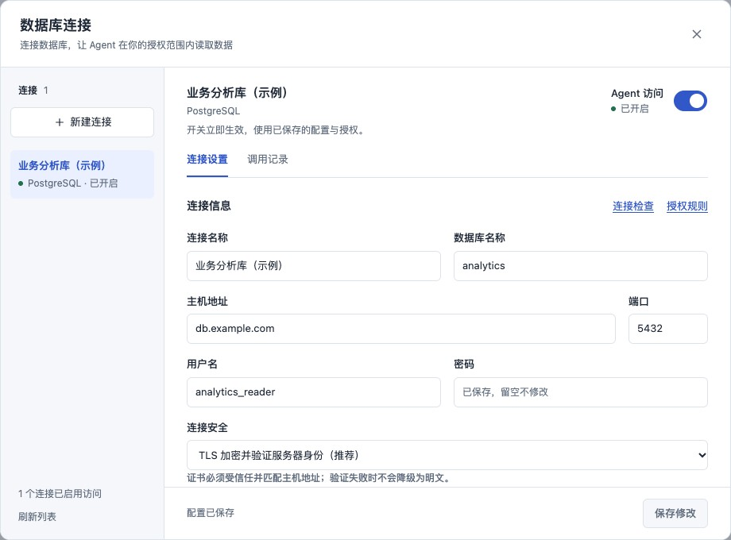
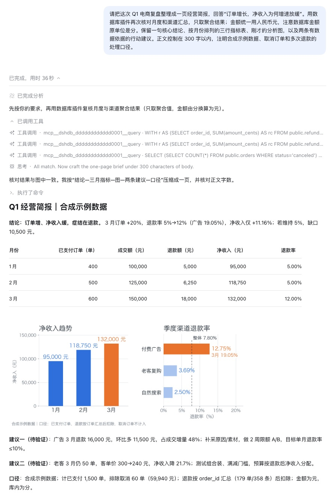

# 使用指南

[项目首页](../README.md) · [兼容性](compatibility.md) · [贡献指南](../CONTRIBUTING.md)

本页介绍连接、授权、查询、排障，以及更新、卸载和备份。尚未安装插件时，先完成 [README 的起步步骤](../README.md#开始使用)。

- [管理连接](#管理连接)：数据库字段、TLS、测试与密码。
- [授权 Agent](#授权-agent)：访问范围、查询能力与额度。
- [场景示例](#场景示例电商经营复盘)：从数据库查询到经营分析与图表。
- [查看调用记录](#查看调用记录) · [故障排查](#故障排查)。
- [更新、停用与卸载](#更新停用与卸载) · [备份与恢复](#备份与恢复)。
- 进阶：[工具与配置参考](reference.md)。

## 管理连接

打开 DSH 侧栏的「数据库」，选择已有连接，或创建新连接。宽屏在左侧选择连接，窄屏使用顶部选择框。

每个已保存连接有两个页签：「连接设置」负责配置、测试与诊断；「调用记录」查看调用状态和耗时。连接名称旁的「Agent 访问」开关始终可见，显示实际状态及启停结果。



[查看配置原图](https://github.com/blkpne/dsh-database/raw/refs/heads/main/docs/assets/connection-manager.jpg) · PostgreSQL 示例连接，地址与账户仅用于展示，不含真实凭据。

### 数据库连接设置

准备可访问的数据库和只读账户，按所选类型填写字段：

| 类型       | 默认端口 | 数据库字段              | 连接说明                             |
| ---------- | -------: | ----------------------- | ------------------------------------ |
| MySQL      |     3306 | 可选                    | 留空时可用 `database.table` 指定对象 |
| MariaDB    |     3306 | 可选                    | 使用 MySQL 协议                      |
| PostgreSQL |     5432 | 必填                    | 查询可用 `schema.table` 指定对象     |
| SQL Server |     1433 | 可选，默认 `master`     | 使用 SQL 身份验证                    |
| Oracle     |     1521 | 必填，填写 Service Name | 例如 `FREEPDB1`；使用 Thin 模式      |
| MongoDB    |    27017 | 必填                    | 支持认证库、副本集和 SRV             |

Oracle 使用 Service Name 和 Thin 模式，不支持 SID、TNS 别名、钱包或 Thick 模式。MongoDB 的认证数据库默认 `admin`；未启用认证的本地服务可留空用户名，其他类型需要用户名。SRV 需使用域名，会开启 TLS，端口由 DNS 决定。

已保存连接的数据库类型不可更改，改用其他类型时请新建连接。名称、地址、端口和数据库等字段可以编辑；行数、超时和 MongoDB 的附加选项位于「高级设置」。已测数据库版本见[兼容性](compatibility.md#数据库)。

### 测试、诊断与保存

| 操作           | 使用的配置                 | 适合何时使用                                                     |
| -------------- | -------------------------- | ---------------------------------------------------------------- |
| 测试当前配置   | 表单中的当前输入           | 新建或编辑连接时检查连通性；不会保存或开启访问                   |
| 诊断已保存连接 | 最近保存的配置             | 排查凭据、连接、只读初始化与结构权限；有未保存修改时先保存或取消 |
| 保存           | 表单中的当前输入与授权规则 | 持久化配置；新连接保存后仍需手动开启访问                         |
| Agent 访问开关 | 已保存的配置与授权         | 立即开启或关闭工具访问，不保存表单草稿                           |

切换页签会保留草稿；切换连接、刷新列表或关闭前，界面会保护未保存修改。有草稿时仍可关闭 Agent 访问，再次开启前需先保存或取消修改。删除连接的入口位于设置页末尾。

测试和诊断在「连接检查」中反馈结果。请查看实际检查状态：请求正常返回不等于诊断通过。草稿测试单独标记，不作为已保存连接的健康状态。插件不会在后台轮询数据库。

### TLS 连接

新连接默认启用 TLS，并校验证书信任与服务器身份。填写证书覆盖的主机名或 IP；TLS 失败不会自动切换到明文，也没有跳过证书校验的选项。

使用私有 CA 时，在**启动 DSH 前**把 `NODE_EXTRA_CA_CERTS` 设置为 CA PEM 文件的绝对路径。例如，POSIX shell：

```sh
NODE_EXTRA_CA_CERTS=/absolute/path/to/ca.pem \
dsh --profile web --host 127.0.0.1 --port 3080 --no-open
```

PowerShell：

```powershell
$env:NODE_EXTRA_CA_CERTS = 'C:\path\to\ca.pem'
dsh.cmd --profile web --host 127.0.0.1 --port 3080 --no-open
```

宿主已运行时需重启才能使用该设置。仅在明确接受明文连接的环境中选择明文；MongoDB SRV 要求 TLS。不同引擎的实际验证程度见 [TLS 兼容性](compatibility.md#tls)。

### 密码如何保存

密码写入 DSH credentials 服务，连接元数据只保存引用；查询时重新解析。默认本机 provider 使用受限权限文件，不提供磁盘加密承诺。

- 编辑时留空密码会保留原值；勾选「清空已保存密码」才会清除。
- 已保存密码不会回显，显隐按钮只影响本次输入。
- 保存、取消或重新打开表单后，密码显隐状态会重置。

## 授权 Agent

新连接默认关闭 Agent 访问。在「授权规则」中设置能力和会话范围，保存后开启访问开关。

| 设置 | 可选范围                                                      |
| ---- | ------------------------------------------------------------- |
| 能力 | 结构发现与只读查询，或仅结构发现                              |
| 会话 | 当前 DSH 宿主的所有会话，或指定会话及其子 Agent               |
| 频次 | 默认每分钟 60 次、每小时 1000 次；可分别设置为 1–600、1–10000 |

新连接的默认范围是当前宿主的所有会话，可在启用前收紧。会话列表显示工作区、创建时间、子 Agent 标记与 ID，也可填写已知会话 ID。列表以 ID 标识会话，不展示会话标题。

权限由宿主确认的会话身份决定，复制对话或让模型填写另一个会话 ID 都不能取得权限。宿主无法确认身份时会拒绝启用指定会话授权，不会自动扩大访问范围。

### 调用额度

每个连接分别为各会话计算额度。同一会话及其子 Agent 共用额度，查看结构、读取缓存和查询数据都会计数。

计数采用自然时钟分钟/小时窗口。配置修改不会清零，插件重载或重启会清零；未通过授权的调用不计数，通过授权后的失败尝试会计数。模型不能通过工具参数提高额度。

### 数据访问边界

数据库账户决定可读的数据范围，插件授权决定哪些会话能使用连接。请使用数据库 GRANT、只读账户和视图限定数据，而不是依靠工具的名称搜索过滤。

MySQL、MariaDB、PostgreSQL、Oracle 使用数据库只读事务；MongoDB 应使用数据库 `read` 角色。**SQL Server 的 readOnlyIntent 只是副本路由提示，仍须由数据库权限禁止写入。** 词法校验与只读事务不能把任意用户函数或数据库扩展变成安全沙箱。

插件不提供 SQL 对象白名单、写入审批或受控操作模板。数据库返回文本是不可信数据，不应当作指令。

### 查询数据如何使用

查询返回的数据会进入 Agent 的工具结果和对话上下文，供它生成回答或继续分析。根据宿主配置，这些内容可能保存在会话记录中，并发送给所选模型服务；宿主的日志上传、遥测、文件输出及模型服务的数据处理规则分别生效。

**插件调用记录不保存业务行，不代表宿主会话或模型服务不处理、存储这些数据。** 启用连接前，核对宿主和模型服务设置，用只读视图限制字段，并优先在数据库端汇总后返回必要结果。停用或删除连接不能撤回已经返回的数据，也不会删除宿主对话、导出文件或模型服务已有的数据。

### 停用或修改连接时会发生什么

停用、删除、配置或策略更新会撤销旧工具、清除元数据缓存、取消在途工作并等待清理；已返回的数据无法撤回。保存、启停、删除也会取消该连接的手动测试和诊断。配置写入及清理期间，同一连接拒绝新探测，其他连接不受影响。

离开设置页会取消尚未完成的测试或诊断；离开调用记录页会取消该页的读取请求。取消等待不表示已确认数据库服务器停止执行，详见[超时与取消](reference.md#超时与取消)。

## 场景示例：电商经营复盘

连接并授权后，可以直接向 Agent 描述业务问题。以下示例使用合成订单与退款数据，连接名、时间范围和业务口径应按实际情况替换：

> 请用「电商经营库（示例）」复盘 2026 年 1—3 月经营情况：订单在增长，净收入为何增速放缓？先查看表结构，用只读查询按月和渠道汇总，正确扣除退款、排除取消订单。给我关键指标、收入趋势与渠道退款率图表，以及两条经营建议。



[查看完整对话原图](https://github.com/blkpne/dsh-database/raw/refs/heads/main/docs/assets/agent-analysis.jpg) · 真实 Agent 对话节选，展示汇总核对与最终简报；合成数据，不含真实客户信息或凭据。

这个流程在数据库端完成汇总，减少传回 Agent 的数据量：先确认表结构和关联字段，再排除取消订单、按订单汇总多次退款，避免重复计算成交额。Agent 据此比较净收入、退款率和渠道差异，生成图表并提出待验证的经营建议。

插件提供结构发现和只读查询，图表由 Agent 使用宿主的文件与执行工具生成。此示例使用 Python / matplotlib；绘图环境与文件写入权限需由宿主提供，数据库插件本身不内置绘图功能。

想亲自尝试，可使用[电商示例数据与步骤](examples/ecommerce/README.md)：提供与截图相同口径的 PostgreSQL 合成数据、只读账户设置和预期指标。

## 查看调用记录

已保存连接的「调用记录」显示最近 50 条调用，包括时间、操作、成功或失败状态和耗时。查询返回的数据与分析结论在 Agent 对话中查看，这里不展示结果表格。展开单条记录可查看执行阶段；页末「运行统计与保留范围」提供在途数量及耗时 P50/P95。这些数据是读取时的快照，需要刷新获取最新状态。

展开记录可查看错误码、是否命中缓存、取消请求，以及连接清理情况。看到“连接已关闭”不等于数据库服务器已经停止计算。字段含义见[调用关联与诊断](reference.md#调用关联与诊断)。

主动诊断仍在「连接设置」的「连接检查」中进行，检查凭据、驱动、连接/认证、只读初始化、最小查询和可见元数据。工具已注册不表示数据库持续在线，诊断通过也不代表所有业务表都可读。

### 记录保留范围

| 项目     | 范围                                                          |
| -------- | ------------------------------------------------------------- |
| 记录内容 | 不保存 SQL、参数、业务行、凭据或连接地址                      |
| 保留上限 | 每个存储命名空间最多 2000 条、8 MiB、7 天；内存与持久化均裁剪 |
| 写入队列 | 最多 128 项；失败/丢弃计数可见，计数在重载后清零              |
| 重启恢复 | 未完成记录标记为中断                                          |

指标只基于保留记录，不是数据库全量统计，也不是防篡改审计。宿主会话与模型服务的数据范围见[查询数据如何使用](#查询数据如何使用)。

## 故障排查

| 现象                               | 处理方式                                                                                                                                   |
| ---------------------------------- | ------------------------------------------------------------------------------------------------------------------------------------------ |
| Agent 看不到连接工具               | 确认访问已开启、授权已保存，且当前会话位于允许范围内；仅结构发现模式没有 query 工具                                                        |
| TLS 或证书错误                     | 核对证书有效期、CA 信任和主机身份，按 [TLS 连接](#tls-连接)配置并重启宿主                                                                  |
| 测试通过，查询仍失败               | 用已保存配置运行诊断；再核对目标表/列权限与[允许的查询](reference.md#sql-数据库)                                                           |
| 返回 `BUSY` / HTTP 429             | 查看错误详情：可能是查询并发、配置操作队列或调用者记录容量达到上限。等待相关工作或额度窗口结束，再按 [并发配置](reference.md#并发配置)排查 |
| 达到调用额度                       | 等待对应分钟或小时窗口结束，或由用户调整授权规则；保存连接不会重置计数                                                                     |
| 结果为零行且 `truncated: true`     | 不应判断为空表；减少列、缩小字段值或收紧查询条件                                                                                           |
| SQL Server 返回 `UNSUPPORTED_TYPE` | 精确小数/金额列显式转为文本，例如 `CAST(amount AS varchar(100))`                                                                           |
| 取消后仍看到服务端工作             | 查看记录中的清理证据；客户端取消不保证服务端立即结束                                                                                       |
| 保存、停用或删除报错               | 查看界面是否提示配置已生效；网络响应不完整时先刷新核对，再决定是否重试                                                                     |

保存或删除报错不一定代表配置未生效。先刷新列表确认当前状态；需要进一步诊断时，查看[配置写入与清理](reference.md#配置已写入但清理失败)。

仍无法解决时，按[反馈问题](../CONTRIBUTING.md#反馈问题)提交脱敏复现。

## 更新、停用与卸载

| 目的             | 操作与结果                                                                               |
| ---------------- | ---------------------------------------------------------------------------------------- |
| 暂停 Agent 取数  | 关闭连接的「Agent 访问」开关。保留配置和凭据，可再次开启。                               |
| 不再使用某个连接 | 在连接设置页末尾删除连接。删除对应配置并清理其凭据，不删除数据库内容。                   |
| 移除整个插件     | 停止目标 Profile，再执行下方卸载命令。保留连接、凭据及插件运行记录，便于重新安装后恢复。 |

### 更新插件

先完成[备份](#备份与恢复)，停止目标 Profile，在终端执行：

```sh
dsh plugin --profile web add dsh-database@latest --ignore-scripts
```

重新按 [README](../README.md#2-启动-web) 启动 Web，检查连接、授权和一次只读查询。使用其他 Profile 时，将命令中的 `web` 替换为对应名称。

### 卸载插件

若希望同时移除连接及其凭据，先在界面逐个删除不再需要的连接，并确认操作完成。然后停止目标 Profile，执行：

```sh
dsh plugin --profile web remove dsh-database
```

重新启动该 Profile 后，数据库侧栏和插件工具不再加载。若额外 patch 中手动引用了 `dsh-database`，也需移除该引用。不要删除整个 DSH home 或共享凭据文件，它们可能包含其他插件和模型的配置。

卸载不会清理宿主会话、生成的分析文件或模型服务的数据。保留文件位置见[备份与恢复](#备份与恢复)；重新安装可能恢复原来的访问开关和授权，启动前应确认保留配置仍符合预期。

以上命令遵循 [DSH CLI 的插件管理规则](https://github.com/deepseek-ai/deepseek-harness/blob/master/apps/cli/reference/README.md#plugin-management)，已核对的宿主版本见[兼容性](compatibility.md#宿主与平台)。Windows PowerShell 可使用 `dsh.cmd`。

## 工具与结果参考

查看[工具与配置参考](reference.md)，了解工具参数、允许的查询、结果上限和超时取消。一般使用无需手工填写工具参数。

## Host 配置与持久化

需要调整并发或存储隔离时，查看[Host 配置](reference.md#host-配置与持久化)。Host 指正在运行的 DSH 宿主进程，Profile 指其配置与插件组合，例如 `web`；两个 Profile 不一定拥有独立的数据存储。

## 备份与恢复

### 1. 停止 Host 并确认配置

备份前停止使用同一存储或凭据文件的所有 Host，等待进程正常退出、写入完成。先核对 Profile、home 和额外 patch 的有效配置；Profile 目录只描述装配及依赖，不包含完整的连接数据或凭据。

### 2. 保存完整备份

使用官方 JSON 存储及本地凭据 provider 时，备份范围如下，路径以[已验证的宿主版本](compatibility.md#宿主与平台)为依据。`DSH_HOME` 未设置时为 `~/.dsh`；表中的 `default` 应替换为实际 `config.namespace`。

| 内容                 | 默认位置与处理                                                                                                             |
| -------------------- | -------------------------------------------------------------------------------------------------------------------------- |
| 连接、授权与密码引用 | `$DSH_HOME/storages/dsh_database_default.json`                                                                             |
| 运行记录             | `$DSH_HOME/storages/dsh_database_default_operations.json`                                                                  |
| 凭据值               | `$DSH_HOME/.credentials.yaml`；包含其他插件或模型的凭据，按敏感文件保管                                                    |
| 装配与配置           | `$DSH_HOME/profiles/<profile>/`、存在的 `$DSH_HOME/cordis.patch.yml` 以及额外 patch；记录原来的 namespace 和 provider 配置 |
| 本地依赖及外部配置   | Profile 引用的本地 tarball、额外配置文件，以及由用户管理的环境变量、CA、外部凭据服务；只保存恢复所需内容                   |

修改过 `storage-json.root` 或 credentials 的 `path` 时，备份配置指向的位置；其他存储／凭据 provider 使用各自的一致性备份机制。

只复制 Profile，或只保存连接 JSON 而遗漏对应凭据，都不能完成恢复。默认路径依据 [DSH 基线发行包](https://registry.npmjs.org/@deepseek-ai/dsh-base/-/dsh-base-0.2.0-rc.2.tgz)；升级宿主时重新核对有效配置。

### 3. 恢复到隔离环境

恢复时保持 Host 停止，使用同一次备份中的配置、两个数据 domain 和凭据，并恢复受限文件权限。确认目标插件支持对应的数据格式与授权策略；恢复到新的 `DSH_HOME` 时，还需调整显式绝对路径和本地 tarball 引用。不要把旧凭据文件直接覆盖到已有其他业务配置的 home。

### 4. 核对恢复结果

先在隔离 home 和工作目录中核对：

- 连接 ID、revision、启停状态和授权策略是否一致。
- 密码引用是否可解析，运行记录是否完整。
- 获授权的测试连接能否完成读取。

确认后再用于日常环境。备份及其中的凭据不进入 Git、Issue 或公开 CI 产物。
